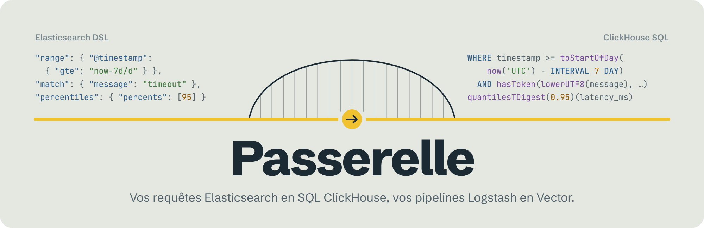
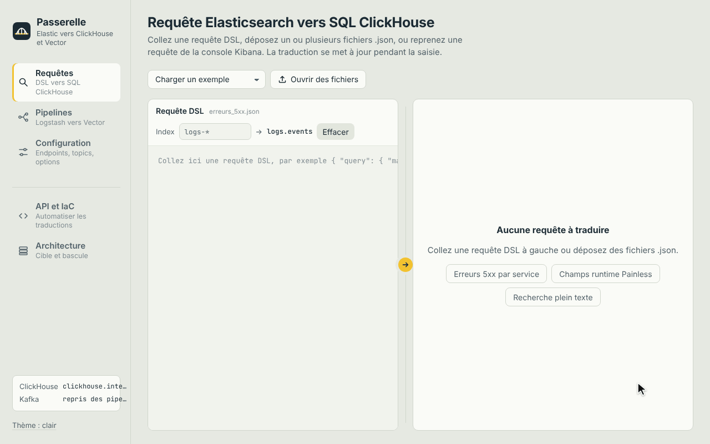
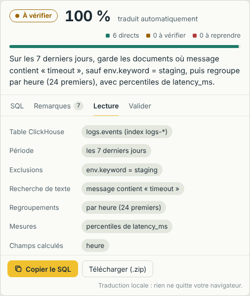
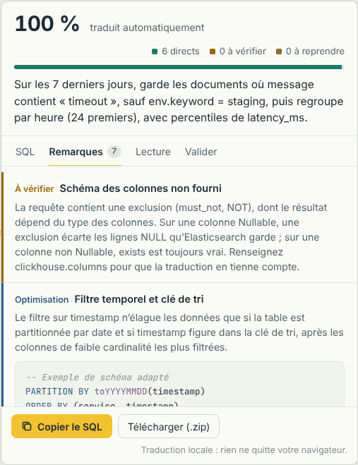
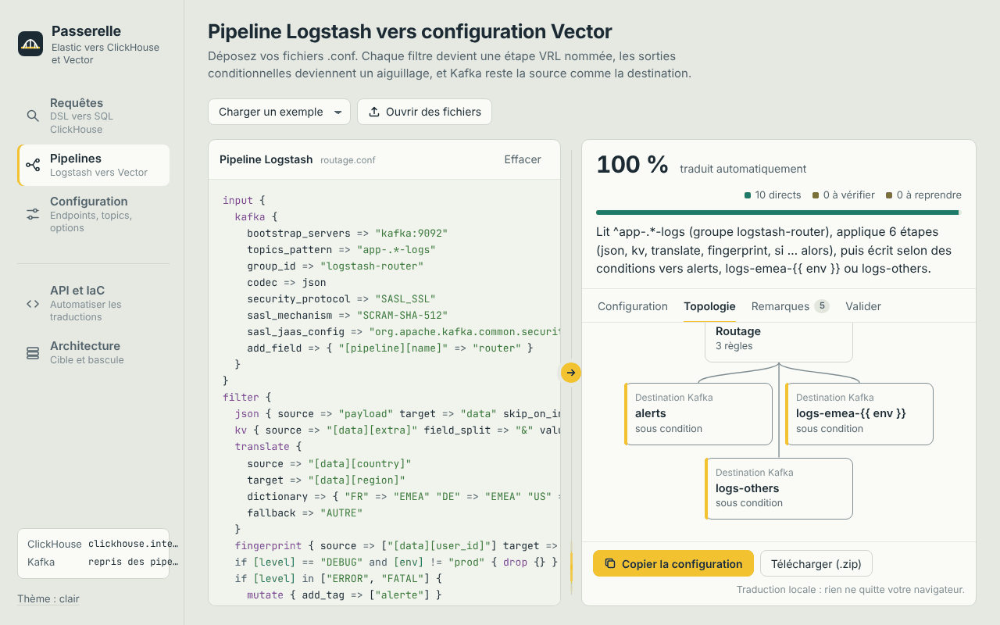

<p align="center">
  <picture>
    <source media="(prefers-color-scheme: dark)" srcset="docs/assets/banner-dark.png">
    
  </picture>
</p>

<p align="center">
  <b>Déposez une requête Elasticsearch ou un pipeline Logstash.<br>
  Passerelle écrit le SQL ClickHouse ou la configuration Vector, l’explique en français et vous montre exactement où regarder.</b>
</p>

<p align="center">
  <a href="https://github.com/OlivMartins/passerelle/releases/latest"></a>
  <a href="https://github.com/OlivMartins/passerelle/actions/workflows/ci.yml"></a>
  <a href="LICENSE"></a>
  
  
  
</p>

<p align="center">
  <a href="https://github.com/OlivMartins/passerelle/releases/latest/download/passerelle.html"><b>Essayer dans le navigateur</b></a>
  &nbsp;&nbsp;|&nbsp;&nbsp;
  <a href="#sur-un-serveur-linux"><b>Installer sur un serveur</b></a>
  &nbsp;&nbsp;|&nbsp;&nbsp;
  <a href="docs/INSTALL.md"><b>Guide complet</b></a>
</p>

<br>

<picture>
  <source media="(prefers-color-scheme: dark)" srcset="docs/assets/demo-dark.gif">
  
</picture>

<br>

## Migrer sans tout réécrire

Quitter Elasticsearch pour ClickHouse, c’est hériter de centaines de requêtes cachées dans les tableaux de bord, les alertes et les scripts, et de dizaines de pipelines Logstash patiemment ajustés. Les réécrire à la main demande une double expertise, prend des semaines et fait courir un risque à chaque ligne.

Passerelle fait ce travail à votre place, fichier par fichier, et rend chaque décision lisible.

<table>
<tr>
<td width="33%" valign="top">

**Il traduit**

Un SQL ClickHouse idiomatique et des configurations Vector typées, produits en quelques millisecondes, y compris les champs runtime Painless et les filtres grok.

</td>
<td width="33%" valign="top">

**Il explique**

Un verdict par requête (prête, à vérifier, à reprendre), un taux de couverture, un résumé en français et des remarques classées. Chacun sait où porter son attention.

</td>
<td width="33%" valign="top">

**Il vérifie**

L’API soumet le SQL à `EXPLAIN` sur votre ClickHouse et compile la configuration avec `vector validate`, pour ne rien envoyer en production à l’aveugle.

</td>
</tr>
</table>

## Avant, après

Une requête typique de tableau de bord, avec un champ runtime Painless. Le SQL qui suit est la sortie réelle de Passerelle, sans retouche.

**Ce que vous déposez :**

```json
{
  "size": 0,
  "runtime_mappings": {
    "heure": { "type": "long", "script": "emit(doc['@timestamp'].value.getHour())" }
  },
  "query": { "bool": {
    "filter": [
      { "range": { "@timestamp": { "gte": "now-7d/d" } } },
      { "match": { "message": "timeout" } }
    ],
    "must_not": [ { "term": { "env.keyword": "staging" } } ]
  } },
  "aggs": {
    "par_heure": {
      "terms": { "field": "heure", "size": 24 },
      "aggs": { "p95": { "percentiles": { "field": "latency_ms", "percents": [95] } } }
    }
  }
}
```

**Ce que Passerelle produit :**

```sql
WITH
    toHour(timestamp, 'UTC') AS heure
SELECT
    heure AS par_heure,
    count() AS doc_count,
    quantilesTDigest(0.95)(latency_ms) AS p95
FROM logs.events
WHERE timestamp >= toStartOfDay(now('UTC') - INTERVAL 7 DAY)
  AND hasToken(lowerUTF8(message), 'timeout')
  AND env != 'staging'
GROUP BY par_heure
ORDER BY doc_count DESC, par_heure ASC
LIMIT 24;
```

Le script Painless devient une expression `WITH`. Le `match` plein texte devient une recherche par tokens, qu’un index peut accélérer. Le percentile garde l’algorithme t-digest d’Elasticsearch, donc des résultats comparables.

Les dates sont calculées en UTC, comme dans Elasticsearch, quel que soit le fuseau du serveur ClickHouse : c’est le rôle des `'UTC'` du SQL. Si votre serveur et vos colonnes sont déjà en UTC, déclarez `timezone: UTC` dans la configuration et le SQL s’en passe.

Passerelle signale aussi que `heure` gagnerait à être une colonne matérialisée et que `message` mérite un index `text`. Le `ALTER TABLE` correspondant est prêt à copier.

## Une lecture pour chacun

<table>
<tr>
<td width="50%" valign="top">

**Pour décider.** Chaque traduction annonce son taux de couverture et se résume en une phrase en français : période, filtres, regroupements, mesures. Un chef de projet sait en dix secondes ce que fait une requête et si elle est prête.

</td>
<td width="50%" valign="top">

**Pour les experts.** Les remarques détaillent chaque choix et proposent le DDL d’optimisation : colonnes matérialisées, index de saut, clé de tri, `LowCardinality`. Le SQL exploite ce que ClickHouse fait de mieux : `LIMIT n BY`, `WITH FILL`, combinateurs `-If`, fonctions fenêtrées.

</td>
</tr>
<tr>
<td valign="top">

<picture>
  <source media="(prefers-color-scheme: dark)" srcset="docs/assets/lecture-dark.png">
  
</picture>

</td>
<td valign="top">

<picture>
  <source media="(prefers-color-scheme: dark)" srcset="docs/assets/remarques-dark.png">
  
</picture>

</td>
</tr>
</table>

## Rien de faux annoncé comme juste

Chaque traduction reçoit un verdict, affiché avant le pourcentage, dans l’interface, l’API et la ligne de commande.

| Verdict | Ce qu’il garantit |
|---|---|
| **Prête** | Traduction directe, à relire comme tout code. |
| **À vérifier** | Une approximation ou un écart connu, expliqué dans les remarques. |
| **À reprendre** | Un élément sans équivalent : le SQL s’arrête sur `throwIf` avec un message explicite au lieu de répondre faux. |
| **Non reconnue** | L’entrée n’est pas une requête qu’Elasticsearch accepterait. |

Passerelle lit la requête comme Elasticsearch la lit. Une clé inconnue (`qeury`, `filtre` dans un `bool`, deux clauses dans un même objet) fait refuser la requête. Un paramètre inconnu, ou une option qui change le résultat sans être traduite (`knn`, `min_score`, `operator` d’un `match_bool_prefix`), la rend « à reprendre ». Les options sans effet sur le résultat (`highlight`, `profile`, `boost`) sont simplement signalées.

### Requêtes d’alertes et de tableaux de bord

Les valeurs remplies à l’exécution deviennent des paramètres ClickHouse. Une condition de Watcher :

```json
{ "range": { "@timestamp": { "gte": "{{ctx.trigger.scheduled_time}}||-5m" } } }
```

devient :

```sql
WHERE timestamp >= parseDateTime64BestEffort({scheduled_time:String}, 3, 'UTC') - INTERVAL 5 MINUTE
```

Sont reconnus les modèles de Watcher et des alertes Kibana (`{{…}}`) et les variables de Grafana (`$__timeFrom`, `${service}`, `[[service]]`, `$service`). La valeur se passe à l’exécution : `param_scheduled_time=…` en HTTP, `--param_scheduled_time=…` avec clickhouse-client. Un modèle placé là où ClickHouse exige une valeur fixe, comme une recherche plein texte, rend la requête « à reprendre ».

## Logstash vers Vector, Kafka compris

<picture>
  <source media="(prefers-color-scheme: dark)" srcset="docs/assets/pipelines-dark.png">
  
</picture>

- **Chaque filtre devient une étape VRL nommée** : grok, dissect, date, mutate, json, kv, geoip, translate, fingerprint, et seize autres. Le code est typé selon les règles du compilateur VRL : aucune erreur ignorée en silence.
- **Les sorties conditionnelles deviennent un aiguillage** `route`, avec une destination par branche.
- **Kafka reste au cœur du flux** : mêmes topics, groupe de consommateurs, SASL et TLS. Les identifiants sont référencés par des variables d’environnement plutôt qu’écrits en clair ; depuis la 0.57, Vector ne les remplace qu’avec l’option `--dangerously-allow-env-var-interpolation`, que rappelle l’en-tête du fichier généré.
- **Elasticsearch en sortie, configuration comprise** : identifiants lus dans des variables d’environnement, TLS, data streams, identifiant de document et pipeline d’ingestion. Ce qui n’a pas d’équivalent dans Vector (mise à jour de documents, modèles d’index, ILM) est signalé.
- **Rien ne change pour les consommateurs** : `@timestamp`, `@version` et le format de date de Logstash sont reproduits.
- **Logstash 8 et ECS** : avec `vector.ecs_compatibility: v8` (par défaut, comme Logstash 8 et suivants), la traduction reproduit `[event][original]`, les noms ECS des motifs grok composites (Apache, syslog) et les cibles ECS de `fingerprint` et `translate`. `disabled` garde les conventions d’avant ; un réglage `ecs_compatibility` du pipeline l’emporte.
- **Bascule sans risque** : en mode shadow, Vector lit avec son propre groupe et écrit dans des topics `-shadow`, à côté de Logstash, le temps de comparer.

<details>
<summary><b>Voir un pipeline traduit</b></summary>

<br>

```ruby
filter {
  grok {
    match => { "message" => "%{IP:ip} %{WORD:verbe} %{NUMBER:statut:int}" }
  }
  if [statut] >= 500 {
    mutate { add_tag => ["erreur"] }
  }
}
```

devient (extrait de la configuration générée) :

```yaml
transforms:
  grok:
    type: remap
    inputs: [kafka_in_init]
    source: |
      # grok
      parsed, err = parse_grok(.message, s'%{IP:ip} %{WORD:verbe} %{NUMBER:statut}')
      if err == null {
        . = merge(object!(.), parsed)
        .statut = to_int(.statut) ?? .statut
      } else {
        .tags = compact(flatten([.tags, "_grokparsefailure"]))
      }
  condition_2:
    type: remap
    inputs: [grok]
    source: |
      if (to_float(.statut) ?? 0.0) >= 500 {
        # mutate
        .tags = compact(flatten([.tags, "erreur"]))
      }
```

</details>

## Prouver l’équivalence sur vos données

Le banc différentiel de Passerelle prouve la traduction sur un jeu de données de test. `passerelle verify` rejoue la même preuve sur **vos** données : chaque requête est jouée sur votre Elasticsearch, sa traduction sur votre ClickHouse, sur une fenêtre de temps close, et les deux résultats sont comparés ligne à ligne (clés, comptes, mesures, ordre).

```bash
# Un rapport daté, une ligne par requête (Markdown, HTML, CSV et JSON dans rapport/)
passerelle verify queries requetes/ --index 'logs-*' --out rapport/

# Les pipelines : un échantillon du topic Kafka d’entrée, rejoué dans votre Logstash et dans le Vector traduit
passerelle verify pipelines pipelines/web.conf --sample echantillon.ndjson \
  --logstash-bin /usr/share/logstash/bin/logstash --out rapport/
```

Chaque requête ou pipeline reçoit un état : **identique**, **différent** (avec l’écart et les deux valeurs), **non concluant** (pas de quoi conclure), **non comparé** (traduction à reprendre, point-in-time, pipeline relié à d’autres) ou **en erreur**. Rien n’est jamais « identique » sans preuve : deux résultats vides, une réponse partielle d’Elasticsearch ou un échantillon qui ne produit aucun événement sont signalés comme tels. Pour un rapport qui quitte l’organisation, `--no-values` retire toute valeur des données (clés de groupe, identifiants, champs, nom du cluster) et ne garde que des comptes.

Les deux moteurs ne sont lus qu’en lecture seule : Elasticsearch ne reçoit que `GET /` et `POST /<index>/_search`, ClickHouse que des `SELECT` sous `readonly = 1`. Les comptes conseillés sont décrits dans le [guide d’installation](docs/INSTALL.md#équivalence-sur-vos-données).

## Au-delà des requêtes : Kibana, Grafana, schéma, ingestion

Une migration ne se limite pas aux requêtes. Passerelle lit aussi ce qui les entoure, avec les mêmes verdicts (prête, à vérifier, à reprendre, non reconnue).

- **Inventaire Kibana** (`passerelle kibana export.ndjson`) : le catalogue des objets sauvegardés (index patterns, recherches, visualisations, Lens, cartes, tableaux de bord, alertes, règles de sécurité, connecteurs, canvas, graphes), objet par objet, en Markdown, HTML, CSV ou JSON. Les requêtes KQL, Lucene et DSL qu’ils portent sont traduites en SQL.
- **Tableaux de bord Grafana** (`passerelle grafana tableau.json`) : les panneaux dont la source est Elasticsearch deviennent des requêtes ClickHouse, avec un rapport par panneau.
- **Schéma** (`passerelle schema ddl mapping.json`) : le `CREATE TABLE` ClickHouse déduit d’un mapping Elasticsearch, y compris les préréglages OpenTelemetry `otel` (attributs en `Map`) et `otel-json` (colonnes `JSON` typées). `passerelle schema pull` lit les tables déjà créées pour que les traductions s’y adaptent.
- **Pipelines d’ingestion Elasticsearch** (`passerelle ingest pipeline.yml`) : chaque processeur devient une étape VRL pour Vector (`append`, `convert`, `date`, `dissect`, `dot_expander`, `foreach`, `geoip`, `grok`, `gsub`, `json`, `kv`, `pipeline`, `rename`, `script` Painless, `set`, `user_agent`, et une vingtaine d’autres). Vector refuse toute la configuration si un seul VRL ne compile pas : la CI compile donc les traductions avec `vector validate`.
- **Sortie ClickHouse** : avec `vector.elasticsearch_output: clickhouse`, la sortie `elasticsearch` d’un pipeline Logstash devient un puits ClickHouse. Il écrit avec son propre compte, `clickhouse.sink_user` ([compte de la sortie Vector](docs/INSTALL.md)).
- **Plusieurs pipelines** : `passerelle ls2vector pipelines.yml` relie les pipelines qui s’appellent entre eux.
- **Analyseurs personnalisés** (`passerelle schema analyzers mapping.json`) : un analyseur Elasticsearch devient une colonne de mots calculée et un index plein texte ClickHouse, avec l’aperçu des mots produits. [Ce qui est repris, et les écarts](docs/ANALYSEURS.md).

Tout cela est aussi dans l’interface (sections « Ingestion », « Kibana » et « Autres sources » ; la section « Kibana » montre, panneau par panneau, les requêtes SQL d’un tableau de bord déposé), dans l’API (`/v1/schema/ddl` et `/v1/schema/analyzers` pour le schéma) et en ligne de commande.

## Une configuration, versionnée avec votre code

Un seul fichier décrit votre plateforme cible. L’interface, l’API et la ligne de commande le lisent de la même façon : il se range dans Git, à côté des requêtes et des pipelines qu’il sert à traduire.

```yaml
clickhouse:
  endpoint: https://clickhouse.internal:8443
  user: '${CLICKHOUSE_USER}'          # secrets résolus au déploiement
  password: '${CLICKHOUSE_PASSWORD}'
  text_fields: [message, error.message]
  index_mapping:
    'logs-*': logs.events             # index Elasticsearch → table ClickHouse
  field_mapping:
    '@timestamp': timestamp
  columns:                            # types des colonnes : facultatif, mais nécessaire à une traduction fidèle
    env: LowCardinality(Nullable(String))
    tags: Array(String)
    latency_ms: UInt32
kafka:
  bootstrap_servers: kafka-1:9092,kafka-2:9092
  consumer_group: vector-logs
vector:
  acknowledgements: true              # offsets validés après écriture seulement
  shadow_mode: false
  ecs_compatibility: v8               # comme Logstash 8+ ; disabled pour les pipelines d’avant ECS
```

### Donnez-lui le schéma de vos colonnes

Elasticsearch et ClickHouse ne répondent pas pareil dès qu’un champ est facultatif, multivalué ou entier. `columns` indique à Passerelle le type de chaque colonne, et la traduction s’adapte :

| Colonne | Ce que Passerelle écrit |
|---|---|
| `Nullable` | Un `must_not` garde les lignes `NULL`, comme Elasticsearch garde les documents sans le champ : `(env != 'staging' OR env IS NULL)`. Un regroupement les écarte. |
| `Array` | Un champ multivalué : `has(tags, 'a')` pour un `term`, `arrayJoin(tags)` pour un regroupement, `notEmpty(tags)` pour `exists`. |
| Entier | La division de deux entiers d’un script Painless devient `intDiv()`, entière comme en Java. |
| Date | Une borne numérique est lue comme un instant en epoch millis. |

Une requête suffit à produire ce bloc :

```sql
SELECT concat('    ', name, ': ', type)
FROM system.columns
WHERE database = 'logs' AND table = 'events'
FORMAT TSVRaw
```

Sans `columns`, Passerelle traduit comme si toutes les colonnes étaient simples et non `Nullable`, et le signale par une remarque « à vérifier » sur les requêtes concernées.

Si vos colonnes de texte ne sont pas `Nullable` et qu’une chaîne vide y représente un champ absent, ajoutez `empty_as_missing: true` : `exists` devient `colonne != ''`, et les regroupements ignorent les chaînes vides.

### Recherche plein texte : lisible ou stricte

L’analyseur standard d’Elasticsearch ne découpe pas un texte comme `hasToken()` : pour lui, `user_id`, `10.0.0.1`, `index.html` et `don't` sont chacun un seul mot. Passerelle découpe le texte cherché comme Elasticsearch, puis cherche chaque mot.

| `text_match` | Ce que Passerelle écrit | Équivalence |
|---|---|---|
| `tokens` (par défaut) | `hasToken(lowerUTF8(message), 'timeout')` pour un mot simple ; les fragments d’un mot composé doivent en plus se suivre | Un mot simple trouve aussi ses occurrences collées par `_`, `.` ou une apostrophe : `user` trouve `user_id` |
| `strict` | La même recherche, suivie d’une expression régulière qui vérifie que le mot apparaît entier | Identique à Elasticsearch sur tous les cas du banc de tests |

La casse est ignorée comme le fait Elasticsearch, lettres accentuées comprises : `échec` trouve `Échec`. C’est le rôle de `lowerUTF8()`, là où `hasTokenCaseInsensitive()` ne connaît que l’ASCII.

Dans les deux modes, `hasToken` reste en tête de condition : c’est lui qu’un index `text` exploite, pourvu qu’il soit construit sur la même expression. Passerelle en donne le DDL avec chaque requête concernée :

```sql
ALTER TABLE logs.events
    ADD INDEX idx_message_text lowerUTF8(message) TYPE text(tokenizer = splitByNonAlpha);
ALTER TABLE logs.events MATERIALIZE INDEX idx_message_text;
```

Sans l’index, le SQL donne le même résultat en lisant toute la colonne. Une phrase (`match_phrase`) est cherchée mots à la suite, quels que soient les séparateurs : `connection reset` trouve `connection-reset`.

### Listes noires et listes blanches

Un `terms`, une série de `should` sur le même champ (le filtre « est l’un de » de Kibana) ou des `OR` dans une `query_string` sont réunis en un seul `IN`.

Au-delà de 256 Kio, ClickHouse refuse une requête : une liste de quelques dizaines de milliers de valeurs suffit. Fixez un seuil, et les listes plus longues quittent le SQL pour une table :

```yaml
clickhouse:
  lists:
    threshold: 200                    # au-delà de 200 valeurs, la liste devient une table nommée
    names:
      c70cbd66b3c3: robots_connus     # facultatif : un nom lisible pour une empreinte
```

```sql
WHERE host NOT IN (SELECT value FROM logs.passerelle_lists WHERE name = 'robots_connus')
```

Le nom par défaut est l’empreinte du contenu de la liste : la même liste dans trois cents tableaux de bord ne donne qu’une entrée. Passerelle fournit le `CREATE TABLE` et les `INSERT`, dans le champ `lists` de l’API et dans un fichier `.lists.sql` à côté de chaque requête traduite par la CLI.

## Démarrer

### Dans le navigateur, sans rien installer

Téléchargez [`passerelle.html`](https://github.com/OlivMartins/passerelle/releases/latest/download/passerelle.html) et ouvrez-le. L’interface complète fonctionne hors ligne, sans serveur, et rien ne quitte votre poste.

### Sur un serveur Linux

```bash
curl -LO https://github.com/OlivMartins/passerelle/releases/download/v1.5.0/passerelle-1.5.0-linux-x86_64.tar.gz
tar xzf passerelle-1.5.0-linux-x86_64.tar.gz && cd passerelle-1.5.0-linux-x86_64
sudo ./install.sh
```

Un seul binaire, Node.js embarqué, aucune dépendance à installer. Le service systemd démarre sur `127.0.0.1:8080`, avec une API protégée par un jeton généré à l’installation. Il faut une distribution Linux x86_64 récente (glibc 2.28+ : RHEL 8, Debian 10, Ubuntu 20.04 ou plus récent). Configuration, reverse proxy, mise à jour : tout est dans le [guide d’installation](docs/INSTALL.md).

### En conteneur

```bash
docker build -t passerelle .
docker run --rm -p 127.0.0.1:8080:8080 --read-only --tmpfs /tmp \
  -e PASSERELLE_TOKEN="$(openssl rand -hex 32)" \
  -v "$PWD/passerelle.yaml:/etc/passerelle/passerelle.yaml:ro" passerelle
```

L’image tourne sous un utilisateur sans privilège et accepte un système de fichiers en lecture seule. Elle ne contient pas Vector : `/v1/validate/vector` y répond 503.

### Dans votre intégration continue

```bash
# Traduit des dossiers entiers ; code de sortie 2 si un fichier est à reprendre (todo), ou pas prêt (review)
passerelle dsl2sql   requetes/  --config passerelle.yaml --out build/sql    --fail-on todo
passerelle ls2vector pipelines/ --config passerelle.yaml --out build/vector --fail-on review

# Ou à la demande, par l’API REST
curl -sS -X POST "http://127.0.0.1:8080/v1/translate/dsl?index=logs-*" \
  -H "Authorization: Bearer $PASSERELLE_TOKEN" --data-binary @requete.json | jq -r .sql
```

| Route | Rôle |
|---|---|
| `POST /v1/translate/dsl` | Requête DSL (JSON ou format console Kibana) vers SQL, avec verdict, paramètres, remarques et couverture |
| `POST /v1/translate/logstash` | Pipeline `.conf` vers configuration Vector, en YAML ou TOML, avec verdict |
| `POST /v1/validate/sql` | `EXPLAIN indexes = 1` sur votre ClickHouse, en lecture seule, après contrôle des tables lues |
| `POST /v1/validate/vector` | Compilation complète de la configuration et du VRL par `vector validate` |

## Exploiter le service

`passerelle serve` s’exploite comme le reste de votre parc, sans agent à poser à côté :

- **Métriques Prometheus** sur `/metrics` : requêtes, durées, refus, verdicts des traductions, validations, rechargements. Les étiquettes sont en nombre fixe (une route inconnue est « autre »), jamais tirées de la requête.
- **Traces OpenTelemetry** (OTLP/HTTP) : un span par requête, un span enfant par appel à ClickHouse ou à Vector. Un `traceparent` entrant est repris, et ClickHouse reçoit le sien. Aucun span ne contient de requête ni de SQL.
- **Identifiant de requête** : chaque réponse porte un `X-Request-Id`, repris dans le journal, l’audit et les spans. Celui d’un reverse proxy de confiance est adopté ; celui d’un autre client est gardé à part.
- **Journal d’audit** : une ligne JSON par appel à l’API, refusés compris, avec le jeton, l’identité, l’action et l’empreinte du corps. **Jamais le contenu de la requête.** Rotation prise en compte au rechargement (`SIGHUP`).
- **Jetons multiples à portée** : un jeton par client, chacun limité à `translate`, `validate` ou `metrics`. Le service refuse de démarrer quand la variable d’un jeton est vide.
- **Identité du reverse proxy** : l’utilisateur que votre SSO a authentifié (`X-Forwarded-User`) entre dans le journal et l’audit, mais seulement quand il vient d’un proxy déclaré de confiance.

```yaml
server:
  tokens:
    - { name: ci, token: '${PASSERELLE_TOKEN_CI}', scopes: [translate, validate] }
    - { name: prometheus, token: '${PASSERELLE_TOKEN_PROMETHEUS}', scopes: [metrics] }
  trusted_proxies: [127.0.0.1]
  identity_header: X-Forwarded-User
  audit_log: /var/log/passerelle/audit.jsonl
  tracing: { endpoint: 'http://collecteur:4318/v1/traces' }
```

Tout est détaillé dans le [guide d’installation](docs/INSTALL.md#jetons-à-portée-identité-et-audit).

## Sécurité et confidentialité

- **Vos requêtes restent chez vous.** L’interface traduit dans le navigateur, hors ligne, sans police ni script externe ni télémétrie.
- **Service durci.** Utilisateur dédié sans privilège, système de fichiers en lecture seule, filtre seccomp vérifié sur les appels système réellement utilisés. Score `systemd-analyze security` : 1.2, « OK ».
- **API sobre.** Jetons comparés en temps constant et limités à une portée, journal d’audit sans contenu de requête, requêtes intersites refusées, politique CSP stricte, corps limités à 2 Mio. La validation SQL n’accepte qu’un `SELECT` sur les tables de la configuration, vérifiées par `EXPLAIN AST` avant toute exécution, en `readonly`. Le compte ClickHouse conseillé est décrit dans le [guide d’installation](docs/INSTALL.md#compte-clickhouse-de-validation).
- **Lecture seule chez vous.** `passerelle verify` n’envoie à Elasticsearch que des `_search` et à ClickHouse que des `SELECT` en `readonly`, et `--no-values` garde les données du client hors du rapport.
- **Secrets hors des fichiers.** Par défaut, les mots de passe sont des références `${VARIABLE}`, aussi bien dans la configuration de Passerelle que dans les configurations Vector qu’il génère.

Une faille à signaler ? Suivez la [politique de sécurité](SECURITY.md).

## Ce que Passerelle sait traduire

**28** types de requêtes, **51** agrégations, **25** filtres Logstash, **35** processeurs d’ingestion, avec les langages qui vont avec : Painless, syntaxe Lucene et grok. Les cas approchés sont signalés « à vérifier », les cas non traduits « à reprendre », sans jamais passer inaperçus.

Le SQL généré vise ClickHouse 26.9 et les versions suivantes. Un [banc différentiel](tests/README.md) exécute les mêmes requêtes sur Elasticsearch 7.17, 8.19 et 9.5 et sur ClickHouse, puis compare les résultats : la CI le joue sur les trois versions à chaque changement et avant chaque release.

<details>
<summary><b>Couverture détaillée</b></summary>

<br>

| Domaine | Pris en charge |
|---|---|
| Requêtes | `bool`, `term`, `terms`, `range` (date math, fuseaux), `exists`, `prefix`, `wildcard`, `regexp`, `fuzzy`, `ids`, `match`, `match_phrase`, `match_phrase_prefix`, `match_bool_prefix`, `multi_match`, `combined_fields`, `query_string`, `simple_query_string`, `constant_score`, `dis_max`, `boosting`, `function_score`, `script_score`, `script`, `nested`, `geo_distance`, `match_all`, `match_none` |
| Métriques | `avg`, `sum`, `min`, `max`, `value_count`, `cardinality`, `stats`, `extended_stats`, `percentiles`, `percentile_ranks`, `weighted_avg`, `top_metrics`, `boxplot` |
| Regroupements | `terms` (imbriqués, top N par parent), `multi_terms`, `rare_terms`, `significant_terms`, `significant_text`, `date_histogram`, `auto_date_histogram`, `histogram`, `range`, `date_range`, `ip_range`, `filter`, `filters`, `missing`, `global`, `composite` (pagination), `top_hits`, `geohash_grid`, `geotile_grid`, `nested`, `reverse_nested`, `sampler`, `diversified_sampler` |
| Pipelines d’agrégation | `bucket_selector`, `bucket_script`, `bucket_sort`, `cumulative_sum`, `derivative`, `serial_diff`, `moving_fn`, `moving_avg`, `avg_bucket`, `sum_bucket`, `min_bucket`, `max_bucket`, `stats_bucket`, `extended_stats_bucket`, `percentiles_bucket` |
| Requête complète | `runtime_mappings`, `script_fields`, `_source`, `sort` (y compris scripté), `search_after`, `collapse`, `post_filter`, `track_total_hits`, `timeout`, format console Kibana |
| Painless | Conditions, variables, `params`, dates et fuseaux (`ZonedDateTime`, `ChronoUnit`), chaînes, `Math`, conversions, `grok()` et `dissect()` |
| Filtres Logstash | `grok` (60 motifs intégrés et motifs personnalisés), `dissect`, `date`, `mutate` (15 opérations), `json`, `kv`, `csv`, `xml`, `useragent`, `geoip`, `translate`, `fingerprint`, `uuid`, `urldecode`, `split`, `truncate`, `cidr`, `drop`, `prune`, `de_dot`, `syslog_pri`, `clone`, `throttle`, `environment`, `bytes` |
| Pipelines d’ingestion Elasticsearch | `append`, `bytes`, `community_id`, `convert`, `csv`, `date`, `dissect`, `dot_expander`, `drop`, `fail`, `fingerprint`, `foreach`, `geoip`, `grok`, `gsub`, `html_strip`, `join`, `json`, `kv`, `lowercase`, `pipeline`, `registered_domain`, `remove`, `rename`, `reroute`, `script`, `set`, `split`, `terminate`, `trim`, `uppercase`, `uri_parts`, `urldecode`, `user_agent` |
| Analyseurs | char_filters, tokenizers et filtres listés dans [docs/ANALYSEURS.md](docs/ANALYSEURS.md) |
| Entrées et sorties | Kafka en entrée et en sortie (SASL, TLS, clés de message, compression) ; aussi `beats`, `tcp`, `udp`, `http`, `file`, `elasticsearch`, `stdout` |
| Conditions Logstash | `if` / `else if` / `else`, `and`, `or`, `xor`, `nand`, `not`, `in`, `not in`, `=~`, `!~`, comparaisons |

**Limites connues.** Dans une requête, les boucles Painless ne sont pas traduites. Dans un pipeline d’ingestion, les scripts sont traduits avec leurs boucles (`for`, `while`, bornées), lambdas, flux `stream()`, expressions régulières, références vers les objets de `ctx`, tris, dates et fonctions récursives (bornées en profondeur) ; une anticipation dans une expression régulière, `DateTimeFormatter`, `TreeSet` ou une variable rattachée à des objets différents au fil d’une boucle sont à reprendre. Les filtres `ruby` et `aggregate` sont signalés « à reprendre », avec le code d’origine recopié en commentaire et la piste à suivre dans Vector.

</details>

## Construire depuis les sources

```bash
npm ci
npm test                 # traduit chaque exemple et vérifie le résultat
npm run test:diff        # compare les résultats de ClickHouse à ceux d’Elasticsearch (voir tests/README.md)
npm run test:pipelines   # compare les événements de Vector à ceux de Logstash (voir tests/README.md)
npm run build:ui         # dist/passerelle.html : l’interface autonome
npm run build:server     # interface et dist/passerelle.cjs, sans binaire (image conteneur)
npm run build            # interface, binaire Linux x86_64 et archive de release
```

Il faut Node.js 24. La construction du binaire se fait sous Linux x86_64. Le code est organisé ainsi : `src/engine/` pour le moteur de traduction (assemblé dans l’ordre donné par `scripts/engine.mjs`), `src/node/` pour les entrées-sorties de la ligne de commande (assemblé après le moteur), `src/server.js` pour le serveur et la CLI, `src/ui/` pour l’interface, `packaging/` pour l’unité systemd et l’installeur.

## Licence

Passerelle est distribué sous licence [Apache 2.0](LICENSE). Vous pouvez l’utiliser, le modifier et le redistribuer librement, y compris dans un cadre commercial. La licence inclut une concession explicite de brevets. C’est aussi la licence de ClickHouse : votre service juridique la connaît déjà. Les redistributions doivent conserver le fichier [NOTICE](NOTICE).

<br>

<p align="center">
  <sub>Elasticsearch, Kibana et Logstash sont des marques d’Elasticsearch B.V. ClickHouse est une marque de ClickHouse, Inc. Vector est un projet open source maintenu par Datadog.<br>Passerelle est un projet indépendant, sans lien avec ces éditeurs.</sub>
</p>
